# Technical diagrams

<!-- Generated by scripts/generate-diagram-assets.py from
     docs/diagrams.html. Do not edit. -->

14 figures covering the mechanisms XCP's per-call authority decision rests on. Each is traced from the code it describes rather than from the prose about it.

Every figure below is a standalone SVG that carries its own palette for light and dark, so it is legible whichever theme you are reading in. The same figures with their full narrative are in [`diagrams.html`](diagrams.html) — open it from a clone, or read it on the documentation site.

## Contents

- [Section 1 — XCP Architecture](#section-1-xcp-architecture)
- [Section 2 — Security guardrails](#section-2-security-guardrails)
- [Section 3 — Capabilities available](#section-3-capabilities-available)
- [Section 4 — External Network & Tools services](#section-4-external-network-tools-services)
- [Section 5 — Deployment options](#section-5-deployment-options)
- [Section 6 — Overall Ecosystem enabler](#section-6-overall-ecosystem-enabler)
- [Section 7 — System One: classification without authorization](#section-7-system-one-classification-without-authorization)
- [Section 8 — The SDK: one contract, several ports](#section-8-the-sdk-one-contract-several-ports)


## Section 1 — XCP Architecture

### Fig 1.1


Four planes crossed in order. The solid centre line is the only path to a destination; every plane can divert off it, and none can put a request back on it. Dashed lines are lookups and records, not request flow.

### Fig 1.2


What each stream requires. The scope names on the arrows are the literal values trustfirewall.scope_for() derives, which is why the lattice and the firewall can be compared without translation.


## Section 2 — Security guardrails

### Fig 2.1


The pipeline for one tool call. Stages 2, 6 and 10 are highlighted because their position is the control: move 2 later and a flood becomes expensive, move 6 earlier and it has no scope to check, move 10 anywhere but last and something has already left.

### Fig 2.2


Order is the mechanism. The hard gate sits above the operator's declaration, so the declaration cannot reach past it — which is what makes “declare your CIDRs” a safe instruction and “disable the check” an unsafe one.


## Section 3 — Capabilities available

### Fig 3.1



The grid, not the list. The two axes are independent, so the envelope is a function of both legs — and the two marked cells are where the rule and its exception live: A0×H2 is demoted to observation by its weak agent leg, A2×H0 is deliberately not demoted, because the company is itself the principal.

### Fig 3.2


What the destination does with an inbound ticket. The origin's assertion is input, not instruction: six conditions can refuse it outright, and what survives is narrowed per leg against the destination's own ceiling.


## Section 4 — External Network & Tools services

### Fig 4.1


Three kinds, two transformations. The dashed paths are the ones that need a human decision — hosting a package, generating a facade — and keeping them visually distinct from the solid one is the point: 98% of the catalogue is not reachable today.

### Fig 4.2


The two routes, and the two different ways a site boundary affects them. Route B costs 25 more; a residency violation does not cost anything, it removes the candidate.


## Section 5 — Deployment options

### Fig 5.1


The role selector. Three uvicorn targets from one image, so what runs locally is the artefact that gets published — and the release gate boots all three and reads /health before the release is allowed to claim success.

### Fig 5.2


The four options with the difference between them made explicit. Each shape adds exactly one layer of the federation machinery; the bottom panel is what makes D a trust domain rather than four gateways that happen to know each other's addresses.


## Section 6 — Overall Ecosystem enabler

### Fig 6.1


The loop that makes this a protocol rather than a product. Publishing needs no permission (RFC 8615), conformance is levelled and public, a second implementation keeps the suite honest, and the compliance map names five requirements XCP does not cover.


## Section 7 — System One: classification without authorization

### Fig 7.1


Ascending cost, first answer wins, abstention always available. The dashed paths all terminate in the same place: the route the node would have taken anyway. That is what makes a probabilistic component safe to put on this path.

### Fig 7.2


One arrow crosses, and it lands after the decision. The five blocked crossings are not blocked by a check that could be removed — Advice has no field that could express them, which is why the guarantee survives a refactor.


## Section 8 — The SDK: one contract, several ports

### Fig 8.1


The vectors are read from one location by every port; there are no per-language copies, because a copy is how two ports come to be checked against different contracts. The dashed arrow is the gate that keeps the contract honest about its own sources.

---

## Keeping these honest

These files are generated. `docs/diagrams.html` is the source, and CI runs:

```
python scripts/generate-diagram-assets.py --check
```

so a figure edited in one place and not the other fails the build rather than shipping as two versions of the same diagram.
